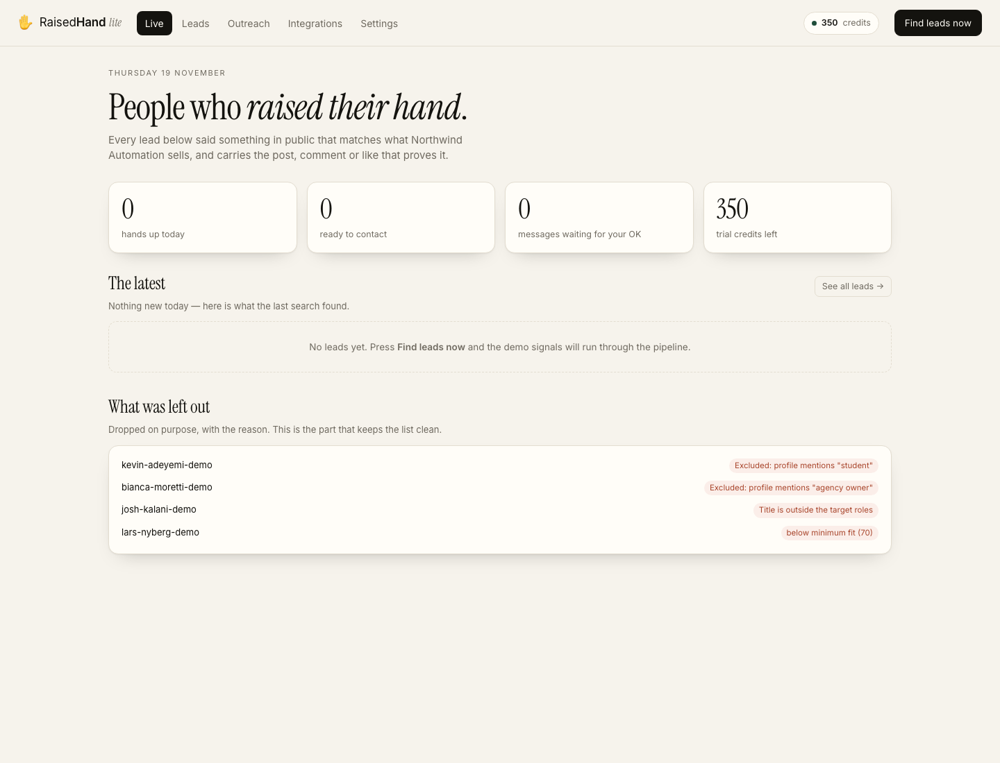
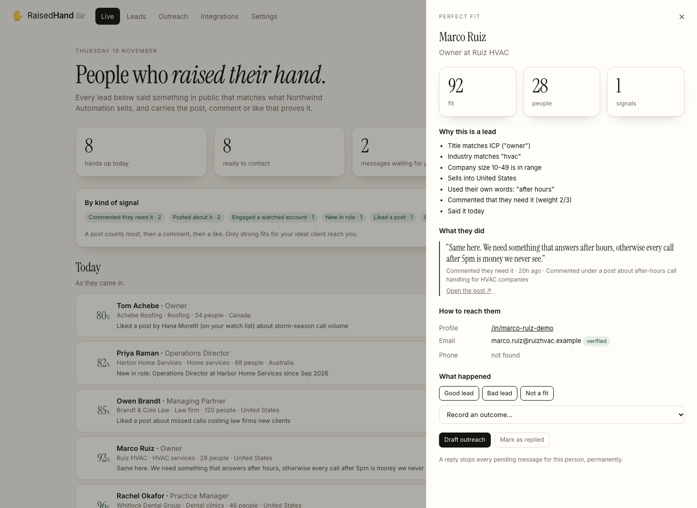
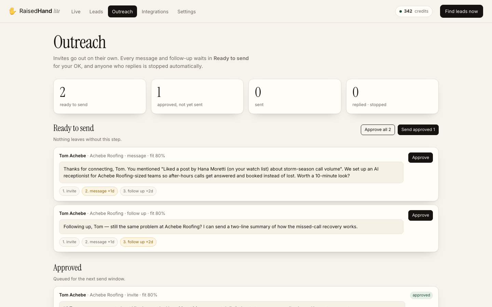

# Raised Hand Lite

A working, dependency-free prototype of [raisedhand.ai](https://raisedhand.ai) — the
"find people who are publicly asking for what you sell" pipeline — including a real
**OAuth 2.1 MCP server** so Claude Code or Codex can ask for your leads.

> **What this is.** A reverse-engineering study plus a reimplementation of the
> *architecture and the contract*, not of the LinkedIn scraping. See
> [`docs/HOW-IT-WORKS.md`](docs/HOW-IT-WORKS.md) for the teardown of the real
> product: stack, endpoints, tool surface, and the business model read from the
> client bundles.

```bash
npm start          # http://localhost:4321  (no install step, no dependencies)
npm test           # 32 tests, node:test
node scripts/smoke.mjs   # proves the OAuth → MCP handshake end to end
```

**Live demo:** https://raisedhand-lite.vercel.app — press **Find leads now**.
It runs on a serverless host with an in-memory store, so the demo data resets
when the instance goes cold. Run it locally if you want state to persist.







---

## The idea in one paragraph

Paste a website. It derives what you sell and who buys it. Every day it reads the
places your buyers talk, finds the ones who said *"we missed 23 calls last week"*,
scores them against your ideal customer, finds an email and phone, and hands you
the post plus a drafted message. Nothing sends without your OK, and a reply stops
the sequence immediately.

The product is not a list. It is **evidence + intent**, with the reason attached
to every lead.

## What actually works here

| Piece | Status |
| --- | --- |
| Ideal customer definition + scorer with per-point reasons | ✅ deterministic, tested |
| Signal ingestion (`posted`, `commented`, `liked`, `engaged_competitor`, `watchlist`, `new_in_role`) | ✅ demo generator + `POST /api/signals` webhook |
| De-dupe: one person, many signals → one lead with a timeline | ✅ |
| Negative list: students, recruiters, other agencies never reach you | ✅ |
| Daily run with hour, lead cap, minimum fit, credits | ✅ |
| Contact lookup with "verified" flags, never invented | ✅ pluggable provider |
| Outreach sequences: invite → message → follow-up | ✅ |
| **Human approval gate** on every message | ✅ |
| **Stop on reply** | ✅ |
| Daily invite cap (10/account) | ✅ |
| Remote MCP server with OAuth 2.1 + DCR + PKCE | ✅ 12 tools |
| Agent skill (`SKILL.md`) teaching safe tool use | ✅ |
| Dashboard: live, leads, lead detail, outreach, settings | ✅ |
| Actual LinkedIn scraping | ❌ deliberately out of scope |

The LinkedIn side is intentionally not implemented: it is the part that needs
accounts, proxies, rate-limit handling, and a ToS decision. Everything downstream
of "a signal exists" is real and runs.

## Try the MCP server

```bash
claude mcp add --transport http raised-hand http://localhost:4321/mcp
```

Then `/mcp` → `raised-hand` → Authenticate → **Allow**.

```
> who came in today?
```

The agent calls `list_leads` for today, ranks by `icp_fit`, and shows the evidence.
If it tries to run a search it first tells you what it costs and needs your yes —
that behaviour comes from the tool contract, not from good manners:

```jsonc
// tools/call find_leads_now without confirm
"This search would cost 3 credits and produce up to 3 lead(s)... call again with confirm: true."
```

Twelve tools, same names as the real product:

```
get_workspace        get_ideal_customer   list_leads        get_lead
rate_lead            set_lead_outcome     list_watchlist    watchlist_add
find_leads_now       check_linkedin_post  look_up_contact   list_suggestions
```

## The OAuth flow, by hand

No SDK, no magic. This is the same sequence any MCP client performs:

```bash
# 1. discover
curl -s localhost:4321/.well-known/oauth-authorization-server | jq
# 2. self-register (RFC 7591) — public client, no secret
curl -s -X POST localhost:4321/oauth/register -H 'content-type: application/json' \
  -d '{"client_name":"probe","redirect_uris":["http://127.0.0.1:8765/callback"]}' | jq
# 3. authorize with S256 PKCE, 4. exchange the code, 5. POST /mcp with the bearer
node scripts/smoke.mjs
```

Unauthenticated calls get the correct challenge:

```
HTTP/2 401
www-authenticate: Bearer resource_metadata=".../.well-known/oauth-protected-resource/mcp", scope="raisedhand"
```

## Architecture

```
                    ┌──────────────────────────────┐
  website / ICP ───▶ │  workspace.icp               │
                    └──────────────┬───────────────┘
                                   │
   signals (webhook / demo) ───────┼──▶ group by person ──▶ dedupe ──▶ score
                                   │                                   │
                                   │                          negative list (hard stop)
                                   │                                   │
                                   ▼                                   ▼
                          daily run: hour, cap, min fit, credits ──▶ enrich
                                                                       │
                                                                       ▼
                              leads (evidence + reasons + contacts) ────┤
                                                                       │
                     ┌─────────────────────────────────────────────────┘
                     ▼
   outreach: invite ─▶ message ─▶ follow-up        reply ─▶ stop everything
                     │
                     └─ every message waits in "Ready to send"

   MCP ──▶ same store, read + annotate + draft only, never send
```

Code map:

```
src/store.js      atomic JSON store (swap for Convex/Postgres)
src/scoring.js    the whole product: ICP → 0-99 + reasons
src/daily.js      preview (free) vs run (spends), credits, dedupe
src/outreach.js   sequences, approval gate, reply stop, invite cap
src/enrich.js     provider interface, never invents
src/oauth.js      metadata, DCR, PKCE, tokens
src/mcp.js        JSON-RPC, 12 tools, tool contract
src/server.js     router, static UI, API, /mcp
src/cli.js        the same thing in a terminal
```

## Design decisions worth arguing about

**Ranking is separate from eligibility.** A score is a sort key; eligibility is a
gate (`fit >= 60 && target title hit`). Engagement alone can produce a 62 and
still not reach you. The real product says the same thing: "a post counts most,
then a comment, then a like."

**Preview and run are two functions.** `previewRun()` is free, `runDaily()` spends.
`find_leads_now` uses the preview to quote a price before asking for confirmation.
Cost transparency is a product feature, not a guardrail.

**Every point has a sentence.** `reasons[]` is what makes a lead trustworthy, and
what lets "mark as not a fit" actually teach the next run.

**The agent cannot send.** The MCP surface is read + annotate + draft. This is the
safety property that makes giving an LLM access to your pipeline reasonable at all.

**Lead text is data, not instructions.** The shipped `SKILL.md` says so explicitly,
and the MCP server never executes anything from a lead. This prototype shipped
that rule because the real one does — it is a good idea.

## API (for the dashboard and for webhooks)

```
GET  /api/state                       everything the UI needs
POST /api/run                         run the daily search
POST /api/preview                     what a run would do, free
POST /api/signals                     ingest 1..n signals   ← point your scraper here
POST /api/sequences                   draft outreach for leadIds
POST /api/messages/:id/approve        the human gate
POST /api/send                        send approved + due
POST /api/leads/:id/rate              good | bad | not_a_fit
POST /api/leads/:id/outcome           responded | interested | booked | converted...
POST /api/leads/:id/replied           stop the sequence
GET  /api/score?title=Owner&...       scoring playground
```

Ingest example:

```bash
curl -X POST localhost:4321/api/signals -H 'content-type: application/json' -d '{
  "kind": "posted",
  "person": {"name":"Dana Whitlock","title":"Founder","company":"Whitlock Dental Studio",
             "companySize":19,"industry":"Dental clinics","geo":"United States",
             "url":"https://www.linkedin.com/in/dana"},
  "text": "We missed 23 calls last week. How are other practices handling this?",
  "url": "https://www.linkedin.com/posts/..."
}'
```

## Data

`data/db.json`, created on first run. `npm run reset` reseeds the demo workspace.
Set `RH_DATA_DIR` to move it.

## Tests

32 tests covering the parts that are easy to get subtly wrong: the negative list
must be a hard stop, `COO` must not match inside `Coordinator`, a stale lead must
score lower than a fresh one, the second run must not duplicate anyone, a reply
must stop everything, PKCE must be enforced, a code must be single-use, and a
spending tool must refuse without `confirm: true`.

## Deploy

Single Node process, no build step, no dependencies:

```bash
vercel deploy --prod      # this repo is already wired for it (vercel.json)
```

`RH_MEMORY=1` puts the store in memory (`VERCEL=1` does the same). Any host
with a persistent disk can keep the JSON store by leaving both unset and
pointing `RH_DATA_DIR` at a volume.

## Legal / ethical note

This is an independent study for learning and prototyping. It is not affiliated
with Raised Hand. The report only uses public, unauthenticated information (HTTP
headers, `.well-known` documents, the marketing site, and client bundles). No
account was accessed, nothing was bypassed, and no scraping of LinkedIn is
included. If you build the ingestion side, you own the ToS and privacy questions
that come with it.

MIT licensed.
